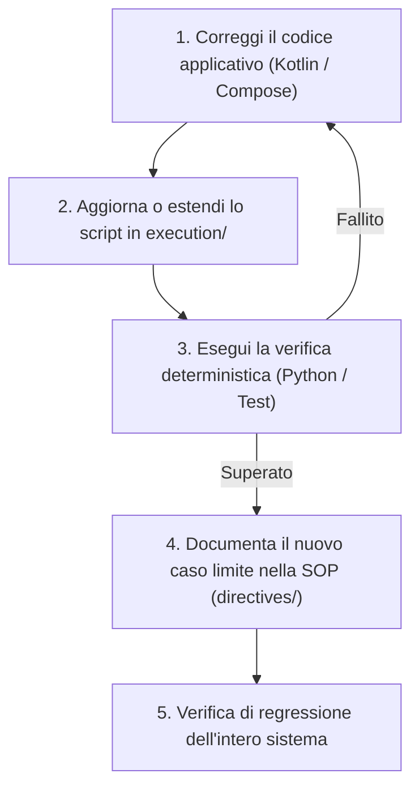

# AGENTS.md — Regole Operative dell'Agente Orchestratore (Livello 2 DOE)

## Architettura del Progetto: Framework DOE (Directives, Orchestration, Execution)
Il progetto **True Scale** (`com.example.truescale`) è strutturato rigidamente secondo il paradigma DOE a tre livelli:

1. **Livello 1: Direttive (`directives/`)**
   - Contiene le Standard Operating Procedures (SOP) in formato Markdown.
   - Definisce: formule fisiche e metrologiche esatte, vincoli hardware del display e dei sensori inerziali, tolleranze geometriche, standard ISO/IEC 7810 e ISO 8653, protocolli di verifica e casi limite documentati.
   - **Regola immutabilità/arricchimento**: Le direttive non vanno mai cancellate o ridotte arbitrariamente. Quando viene scoperto o risolto un nuovo caso limite, la direttiva corrispondente DEVE essere arricchita.

2. **Livello 2: Orchestrazione (Agente AI)**
   - L'agente agisce come ponte logico e decisionale tra direttive ed esecuzione.
   - **Regola preliminare**: L'agente deve sempre consultare le direttive pertinenti (`directives/*.md`) PRIMA di pianificare o toccare codice sorgente.
   - Tutti i file intermedi (log di compilazione, dump matriciali, report di linting Compose, test cache) DEVONO essere confinati esclusivamente in `.tmp/`.

3. **Livello 3: Esecuzione Deterministica (`execution/`)**
   - Script Python autonomi e deterministici (`verify_metrology_math.py`, `audit_compose_perf.py`, `bump_version_and_build.py`).
   - Sostituiscono la validazione probabilistica con calcoli matematici e controlli sintattici rigidi.
   - Vengono eseguiti prima di ogni compilazione e commit per validare la correttezza del codice.

---

## Loop di Auto-Correzione in 5 Step (Self-Correction Loop)
Qualsiasi discrepanza, bug, crash o fallimento di test deve seguire tassativamente questo ciclo iterativo:



1. **Correggi**: Identifica la causa radice nel codice Kotlin e applica la correzione mirata.
2. **Aggiorna lo Script**: Se il difetto non era stato intercettato dagli script in `execution/`, estendi il tester o linter Python per includere quel caso limite specifico.
3. **Testa**: Esegui lo script in `execution/` per ottenere una validazione deterministica al 100%.
4. **Arricchisci la Direttiva**: Aggiorna il file Markdown in `directives/` registrando il caso limite scoperto, la causa hardware/software e la strategia di risoluzione adottata.
5. **Verifica Globale**: Esegui la suite completa di test e la compilazione per garantire zero regressioni.

---

## Mappatura Directory DOE
```
TrueScale/
├── AGENTS.md                          # Regole operative Orchestratore & Loop di auto-correzione
├── .gitignore                         # Esclusione obbligatoria di .tmp, build artifacts e credenziali
├── directives/                        # LIVELLO 1: SOP e specifiche metrologiche/hardware
│   ├── 01_metrology_display_sop.md    # Sub-pixel, xdpi/ydpi, bypass downscaling, ISO/IEC 7810
│   ├── 02_inertial_sensor_fusion_sop.md # Filtro EMA adattivo, atan2, matrice tara 5 facce
│   └── 03_build_and_verification_sop.md # Anti-allocazione Canvas, tnum, bump version, build
├── execution/                         # LIVELLO 3: Script deterministici di verifica ed esecuzione
│   ├── verify_metrology_math.py       # Validatore matematico conversioni, anelli ISO e angoli
│   ├── audit_compose_perf.py          # Linter anti-allocazione DrawScope & font tabular tnum
│   └── bump_version_and_build.py      # Gestore semver, esecuzione gradle e log in .tmp/
├── .tmp/                              # Directory temporanea (MAI committata)
│   ├── build_logs/                    # Log di Gradle e compilazione APK
│   └── reports/                       # Report intermedi di test e linting
└── app/                               # Codice applicativo Android Nativo
    ├── build.gradle.kts               # Configurazione modulo app (minSdk 35, targetSdk 37)
    └── src/main/java/com/example/truescale/
        ├── engine/                    # Motori matematici deterministici (Display & Inerziale)
        ├── data/                      # Persistenza DataStore (calibrazione & offset tara)
        ├── ui/components/             # Componenti Canvas 120Hz (Ruler, Level, IsoCard)
        └── ui/theme/                  # Material 3 Expressive & Tabular typography
```

---

## Regole di Igiene e Vincoli di Sviluppo
1. **Zero Allocazioni in DrawScope a 120 Hz**: È severamente proibito creare istanze di `Paint`, `Path`, `Stroke`, `TextStyle` o qualsiasi oggetto dentro blocchi `Canvas { ... }` o `drawBehind { ... }`. Tutte le proprietà di disegno devono essere pre-allocate nel `remember` o create come costanti.
2. **Numeri Tabulari Obbligatori**: Qualsiasi `Text` che visualizza misure in cm, mm, gradi (°), area o diametro DEVE applicare `fontFeatureSettings = "tnum"` tramite lo stile tipografico `TabularNumberStyle`.
3. **Nessun Uso di Dp per le Misure Metrologiche**: Le dimensioni millimetriche non devono MAI dipendere da `Density.density` o `dp`. Devono derivare esclusivamente da `xdpi` e `ydpi` fisici con compensazione del fattore di scala reale.
4. **Isolamento dei File Temporanei**: Nessun log, report o dump temporaneo deve essere salvato fuori da `.tmp/`.
